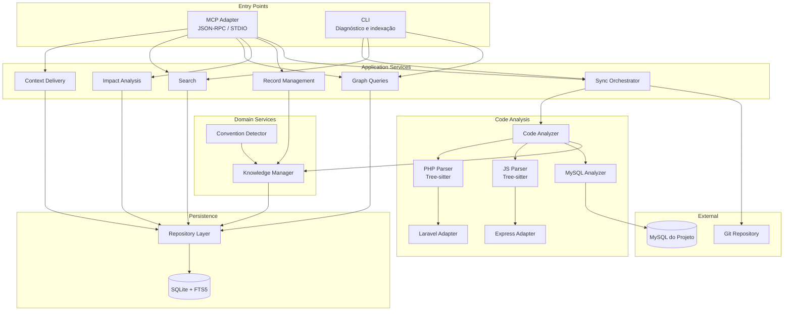

# Project Map MCP — Especificação Técnica v4.0

Nov 13, 2026

**Status:** Especificação definitiva — referência para implementação\
**Substitui:** v1.0, v2.0, v3.0

> Esta especificação define o produto e seus contratos. Ela não afirma que o software já foi implementado ou que as metas de desempenho já foram comprovadas. Toda meta quantitativa deve ser validada por benchmark e registrada como resultado medido.

## 1. Resumo Executivo

O **Project Map MCP** é um servidor Model Context Protocol que mantém uma memória técnica persistente, verificável e compartilhada de um projeto de software. Indexa estrutura de repositório, registra relacionamentos entre componentes, mantém conhecimento funcional com evidências rastreáveis e entrega contexto progressivo a clientes de IA — tudo sem executar código nem chamar LLMs.

### Divisão de responsabilidade

| Responsável | Faz | Não faz |
| --- | --- | --- |
| **MCP** | Descobrir estrutura determinística · armazenar conhecimento com evidências · identificar lacunas e mudanças · validar registros · entregar contexto progressivo · propor planos de investigação | Interpretar intenção do usuário · executar código do projeto · inferência por LLM · decisões de negócio |
| **Cliente de IA** | Interpretar solicitações · investigar lacunas lendo arquivos indicados · comparar evidências · formular explicações · registrar descobertas via tool `record` | Persistir estado entre sessões · parsing determinístico · definir verdade de negócio |
| **Desenvolvedor** | Definir limites de acesso · fornecer decisões de negócio · confirmar informações não determinísticas · validar registros de conhecimento | Manter índice manualmente · gerenciar cache |

O MCP oferece **investigação assistida**: entrega lacunas identificadas, evidências disponíveis e arquivos candidatos. A IA executa a investigação e registra o resultado.

### Resultado esperado

Conversa nova recupera rapidamente o estado conhecido. Regra investigada e válida não é redescoberta. Regra desatualizada ou sem evidência é sinalizada com status e snapshot de origem. Conhecimento persiste no escopo do projeto, não da conversa. Cache de sessão é otimização, nunca fonte de verdade.

### Escopo do MVP

**Incluído:** repositório local único · Git · SQLite + FTS5 · transporte STDIO · PHP e JavaScript (parsers Tree-sitter) · MySQL (analisador de schema) · Laravel e Express (framework adapters) · indexação incremental por snapshots · busca textual e por entidades · grafo com resolução de dependências · contexto progressivo por profundidade/propósito/budget · knowledge records com evidência e validação · detecção de convenções · CLI para diagnóstico e indexação.

**Extensível (pós-MVP):** TypeScript · Python · HTTP/SSE · armazenamento centralizado · deduplicação semântica · multi-repositório.

### Stack alvo

| Tecnologia | Papel | Suporte MCP |
| --- | --- | --- |
| PHP 8.x | Backend | Parser Tree-sitter completo |
| JavaScript ES2020+ | Frontend e tooling | Parser Tree-sitter completo |
| MySQL 8.x | Banco relacional | Analisador de schema via `information_schema` e migrations |
| Laravel 10+ | Framework PHP | Adapter: rotas, Eloquent, Blade, events, jobs, middleware |
| Express 4+ | Framework JS | Adapter: rotas, middleware, error handlers |
| Composer / npm | Dependências | Detector de pacotes e versões |

Agnóstico no domínio. Parsers e adapters priorizam esta stack; a arquitetura permite adicionar qualquer linguagem sem reescrever o core.

## 2. Objetivos, Não Objetivos e Princípios

### Objetivos funcionais

1. **Identificar estrutura automaticamente.** Detectar linguagens, frameworks, diretórios, módulos e tecnologias do repositório sem configuração manual.
2. **Mapear componentes e relacionamentos.** Extrair arquivos, classes, funções, rotas, tabelas, migrations e suas dependências num grafo navegável.
3. **Localizar funcionalidades com evidência.** Permitir busca textual e estrutural que retorne não só a entidade, mas as evidências que sustentam cada afirmação sobre ela.
4. **Entregar contexto progressivo.** Servir informação em camadas — summary → structure → detail → full — controladas por propósito e budget de tokens.
5. **Expor lacunas de conhecimento.** Indicar explicitamente o que o MCP não sabe, com arquivos candidatos para investigação e nível de confiança.
6. **Registrar descobertas com proveniência.** Aceitar knowledge records da IA ou do desenvolvedor, cada um vinculado a evidências, snapshot e status de validação.
7. **Detectar mudanças e invalidar conhecimento.** Processar diffs do Git, propagar staleness pelo grafo de dependências e marcar registros afetados.
8. **Compartilhar entre sessões.** Persistir todo conhecimento no escopo do projeto via SQLite; cache de sessão é derivado e descartável.
9. **Explicar limitações em cada resposta.** Incluir cobertura de análise, resolução de referências e confiança dos dados entregues.

### Não objetivos do MVP

1. Executar código do projeto para descobrir comportamento de runtime.
2. Fazer chamadas autônomas a LLMs para inferência semântica.
3. Corrigir código ou criar commits automaticamente.
4. Substituir IDE, language server ou debugger.
5. Garantir compreensão semântica completa de qualquer framework.
6. Criar serviço SaaS multi-tenant no primeiro release.
7. Usar embeddings ou banco vetorial obrigatoriamente.
8. Sincronizar bancos SQLite entre computadores automaticamente.
9. Indexar segredos, dependências vendorizadas ou artefatos de build.
10. Resolver chamadas dinâmicas, reflection ou dependências de container de IoC.

### Princípios

1. **Evidence first.** Toda afirmação tem origem rastreável ou é marcada como `unverified`. Nenhuma informação é apresentada como fato sem evidência.
2. **Incremental by default.** Reprocessar apenas o que mudou desde o último snapshot. Reconciliação completa periódica como rede de segurança.
3. **Progressive context.** Começar com o mínimo necessário e expandir conforme necessidade e budget. Nunca despejar o índice inteiro.
4. **No silent assumptions.** Referências não resolvidas, tipos dinâmicos e incertezas aparecem explicitamente na resposta, nunca são omitidos.
5. **Project-scoped persistence.** Conhecimento sobrevive à sessão e ao cliente. Cache é derivado e descartável; a verdade está no SQLite.
6. **Deterministic core.** Parsing e indexação estrutural usam Tree-sitter e AST, não dependem de LLM. Resultado reprodutível para o mesmo input.
7. **AI-assisted investigation.** O MCP organiza, valida e persiste. A IA investiga, interpreta e registra. Nenhum dos dois faz o trabalho do outro.
8. **Secure by default.** Todo conteúdo do repositório é dado não confiável. Path traversal, symlinks e injeção são bloqueados antes de qualquer processamento.
9. **Explainable ranking.** A ordem de relevância nos resultados é justificável por componentes visíveis: score textual, proximidade no grafo, recência, confiança.
10. **MVP without infrastructure.** Instalação local não exige Docker, Redis, serviço externo nem banco de dados além do SQLite embutido.

## 3. Arquitetura Geral

### Componentes e fronteiras

| # | Componente | Responsabilidade | Fronteira |
| --- | --- | --- | --- |
| 1 | **MCP Adapter** | Receber JSON-RPC, validar schema, rotear para Application Services | Não contém lógica de domínio. Converte protocolo MCP ↔ chamadas internas |
| 2 | **CLI** | Ponto de entrada independente para indexação, diagnóstico e queries | Usa mesmos Application Services que o MCP Adapter |
| 3 | **Application Services** | Orquestrar casos de uso: context delivery, search, graph queries, impact analysis, record management, sync | Não acessa banco diretamente. Delega a Repository e Domain Services |
| 4 | **Context Delivery** | Montar resposta progressiva respeitando depth, purpose e token\_budget | Consulta Repository para dados; monta e formata a resposta |
| 5 | **Sync Engine** | Detectar mudanças via Git, criar snapshots, disparar re-análise incremental | Não interpreta código. Delega parsing ao Code Analyzer |
| 6 | **Code Analyzer** | Parsear arquivos via Tree-sitter, extrair entidades, relacionamentos e evidências | Não persiste dados. Retorna resultados estruturados ao Sync Engine |
| 7 | **Language Parsers** | Implementações específicas: PHP Parser, JS Parser | Cada parser é um adapter do Code Analyzer. Isolados entre si |
| 8 | **Framework Adapters** | Laravel Adapter, Express Adapter: padrões específicos de framework | Plugados nos Language Parsers. Não acessam banco |
| 9 | **MySQL Analyzer** | Ler `information_schema`, parsear migrations SQL, detectar FKs e índices | Conecta ao MySQL do projeto (read-only). Retorna entidades ao Sync Engine |
| 10 | **Knowledge Manager** | CRUD de knowledge records, validação, versionamento, detecção de duplicatas | Interface única para escrita no domínio de conhecimento |
| 11 | **Repository Layer** | Acesso ao SQLite: queries, transações, FTS5, cache de sessão | Única camada que executa SQL. Toda outra camada usa suas interfaces |
| 12 | **Convention Detector** | Identificar padrões recorrentes: naming, estrutura, configurações | Puro read. Registra convenções via Knowledge Manager |

### Diagrama de componentes



### Regras de dependência

- **Entry Points → Application Services**: MCP Adapter e CLI dependem apenas de Application Services. Nunca acessam Repository ou Domain diretamente.
- **Application Services → Repository + Domain**: Services consultam dados via Repository e delegam escrita de conhecimento ao Knowledge Manager.
- **Domain Services → Repository**: Knowledge Manager e Convention Detector persistem via Repository Layer.
- **Code Analysis → Domain**: Code Analyzer registra entidades e evidências via Knowledge Manager. Não acessa SQLite diretamente.
- **Repository → SQLite**: Única camada com acesso direto ao banco. Todas as queries SQL estão aqui.
- **Dependência proibida**: nenhum componente interno depende do MCP Adapter. Remover o adapter não quebra o domínio.

### Estrutura de diretórios

```
project-map-mcp/
├── src/
│   ├── adapter/           # MCP Adapter (JSON-RPC handler)
│   │   ├── server.js
│   │   └── tools/           # Tool handlers (get_context, search, etc.)
│   ├── cli/               # CLI entry point
│   ├── services/          # Application Services
│   │   ├── context.js
│   │   ├── search.js
│   │   ├── graph.js
│   │   ├── impact.js
│   │   ├── record.js
│   │   └── sync.js
│   ├── domain/            # Domain Services
│   │   ├── knowledge.js     # Knowledge Manager
│   │   └── conventions.js   # Convention Detector
│   ├── analyzer/          # Code Analysis
│   │   ├── core.js          # Orchestrator
│   │   ├── parsers/
│   │   │   ├── php.js
│   │   │   └── javascript.js
│   │   ├── frameworks/
│   │   │   ├── laravel.js
│   │   │   └── express.js
│   │   └── mysql.js         # MySQL schema analyzer
│   ├── repository/        # Repository Layer
│   │   ├── db.js            # SQLite connection + migrations
│   │   ├── entities.js
│   │   ├── knowledge.js
│   │   ├── evidence.js
│   │   ├── graph.js
│   │   └── cache.js         # Session cache
│   └── shared/            # Tipos, constantes, utilitários
│       ├── types.js
│       ├── constants.js
│       └── utils.js
├── migrations/            # SQL migration files
├── test/
├── package.json
└── project-map.config.json     # Configuração por projeto
```

## 4. Modelo de Conhecimento

### Escopos de entidade

| Escopo | Descrição | Exemplos |
| --- | --- | --- |
| `project` | O projeto como um todo | Stack, arquitetura geral, convenções globais |
| `module` | Diretório lógico ou namespace | `app/Services/`, `src/controllers/` |
| `file` | Arquivo individual | `UserController.php`, `auth.js` |
| `symbol` | Classe, função, método, constante | `UserService::create()`, `validateToken()` |
| `database` | Tabela, coluna, índice, FK | `users.email`, `idx_users_status` |
| `external` | Dependência de terceiros | `laravel/framework:^10.0`, `express:^4.18` |

### Tipos de entidade

| Tipo | Escopo | Descrição |
| --- | --- | --- |
| `file` | file | Arquivo no repositório |
| `directory` | module | Diretório lógico |
| `class` | symbol | Classe PHP ou JS |
| `function` | symbol | Função ou método |
| `interface` | symbol | Interface PHP |
| `trait` | symbol | Trait PHP |
| `constant` | symbol | Constante definida |
| `variable` | symbol | Variável de escopo relevante (global, env) |
| `route` | symbol | Rota HTTP (Laravel ou Express) |
| `middleware` | symbol | Middleware registrado |
| `migration` | file | Migration SQL |
| `model` | symbol | Model Eloquent |
| `view` | file | Template Blade ou EJS |
| `event` | symbol | Evento disparado |
| `listener` | symbol | Listener de evento |
| `job` | symbol | Job de fila |
| `command` | symbol | Artisan command ou script CLI |
| `config` | file | Arquivo de configuração |
| `table` | database | Tabela MySQL |
| `column` | database | Coluna de tabela |
| `index` | database | Índice de tabela |
| `foreign_key` | database | Chave estrangeira |
| `package` | external | Dependência Composer ou npm |
| `test` | file | Arquivo de teste |
| `factory` | symbol | Factory de teste |
| `seeder` | symbol | Seeder de banco |

### Tipos de relacionamento (edges)

| Tipo | Direção | Descrição |
| --- | --- | --- |
| `imports` | A → B | A importa/require B |
| `extends` | A → B | A herda de B |
| `implements` | A → B | A implementa interface B |
| `uses_trait` | A → B | A usa trait B |
| `calls` | A → B | A chama função/método de B |
| `instantiates` | A → B | A cria instância de B |
| `references` | A → B | A referencia B (genérico) |
| `belongs_to` | A → B | A pertence ao módulo/diretório B |
| `has_many` | A → B | Relação Eloquent hasMany |
| `belongs_to_model` | A → B | Relação Eloquent belongsTo |
| `has_one` | A → B | Relação Eloquent hasOne |
| `many_to_many` | A ↔ B | Relação Eloquent belongsToMany |
| `maps_to_table` | A → B | Model mapeia para tabela |
| `handles_route` | A → B | Controller/handler processa rota |
| `dispatches` | A → B | A dispara evento/job B |
| `listens_to` | A → B | A escuta evento B |
| `renders` | A → B | Controller/rota renderiza view B |
| `migrates` | A → B | Migration cria/altera tabela B |
| `foreign_key_to` | A → B | Coluna A referencia tabela B |
| `depends_on` | A → B | Dependência genérica (pacote, config) |
| `tests` | A → B | Teste A exercita componente B |

Cada edge carrega:

- `weight` (0.0–1.0): força do acoplamento. `extends` = 0.9, `references` = 0.3.
- `resolution_status`: `resolved` | `ambiguous` | `unresolved`. Chamadas dinâmicas ficam `unresolved`.
- `evidence_id`: referência à evidência que sustenta a relação.
- `snapshot_id`: snapshot em que a relação foi detectada.

### Modelo de evidência

Evidência é entidade de primeira classe, separada do knowledge record.

| Campo | Tipo | Descrição |
| --- | --- | --- |
| `id` | TEXT PK | UUID da evidência |
| `repository_id` | TEXT FK | Repositório de origem |
| `source_kind` | TEXT | `code` \| `comment` \| `docblock` \| `config` \| `migration` \| `test` \| `git_log` \| `manual` |
| `path` | TEXT | Caminho do arquivo (relativo à raiz do repo) |
| `line_start` | INTEGER | Linha inicial no arquivo |
| `line_end` | INTEGER | Linha final no arquivo |
| `symbol_id` | TEXT FK | Entidade associada (opcional) |
| `content_hash` | TEXT | SHA-256 do trecho de código. Permite detectar se a evidência mudou |
| `snapshot_id` | TEXT FK | Snapshot em que foi coletada |
| `commit_sha` | TEXT | Commit específico |
| `excerpt` | TEXT | Trecho literal do código/comentário |
| `created_at` | TEXT | ISO 8601 |

`content_hash` é a chave para invalidar: se o hash mudou entre snapshots, a evidência é stale e todo knowledge que depende dela é marcado como `needs_review`.

### Knowledge records

Cada registro de conhecimento é uma afirmação sobre o projeto, vinculada a evidências.

**Tipos de knowledge:**

| Tipo | Descrição | Exemplo |
| --- | --- | --- |
| `business_rule` | Regra de negócio identificada | "Usuário com status 'blocked' não pode fazer login" |
| `architectural_decision` | Decisão de arquitetura | "Filas processadas via Laravel Horizon" |
| `data_flow` | Fluxo de dados entre componentes | "Request → Middleware Auth → Controller → Service → Repository" |
| `api_contract` | Contrato de API (input/output) | "POST /api/users espera {name, email, role}" |
| `constraint` | Restrição técnica ou de negócio | "Tabela orders não aceita DELETE, apenas soft delete" |
| `pattern` | Padrão de implementação recorrente | "Todos os Services retornam DTOs, nunca Models" |
| `dependency_note` | Nota sobre dependência externa | "Pacote X requer PHP 8.1+" |
| `security_note` | Observação de segurança | "Upload de arquivos validado apenas por extensão" |
| `performance_note` | Observação de performance | "Query N+1 em OrderController@index" |
| `todo` | Trabalho pendente identificado | "TODO: implementar cache de permissões" |
| `explanation` | Explicação funcional de componente | "Este middleware verifica rate limiting por IP" |
| `convention` | Convenção detectada automaticamente | "Todos os controllers usam sufixo Controller" |

**Origem (origin):**

| Valor | Descrição |
| --- | --- |
| `deterministic` | Extraído por parsing de AST (Tree-sitter) |
| `heuristic` | Inferido por padrões no código (convention detector) |
| `ai_generated` | Registrado pela IA via tool `record` |
| `human_provided` | Fornecido pelo desenvolvedor |

**Status de validação (validation\_status):**

| Valor | Descrição |
| --- | --- |
| `unverified` | Registrado mas não verificado contra código |
| `supported_by_code` | Evidência encontrada no código-fonte |
| `supported_by_tests` | Evidência encontrada em testes |
| `human_confirmed` | Confirmado explicitamente por desenvolvedor |
| `disputed` | Evidências conflitantes encontradas |
| `superseded` | Substituído por versão mais recente |
| `invalidated` | Evidência original não existe mais |

**Validade (validity):**

| Valor | Descrição |
| --- | --- |
| `current` | Válido no snapshot mais recente |
| `needs_review` | Evidência mudou; requer revalidação |
| `stale` | Não verificado há mais de N snapshots |
| `archived` | Mantido para histórico, não mais válido |

### Versionamento por inserção

Atualizações de knowledge criam novo registro com `supersedes_id` apontando para o anterior. O registro anterior recebe `validation_status = 'superseded'`. Nunca se altera o registro original — histórico completo é preservado.

```
knowledge_v1 (id: "k-001", content: "Regra X", validity: "superseded")
    └── knowledge_v2 (id: "k-002", supersedes_id: "k-001", content: "Regra X atualizada", validity: "current")
```

### Detecção de duplicatas

Antes de inserir um knowledge record, o Knowledge Manager executa:

1. **FTS5 similarity**: busca textual no `content` com threshold de similaridade.
2. **Entity overlap**: verifica se as entidades vinculadas se sobrepõem.
3. **Type match**: mesmo `knowledge_type` aumenta chance de duplicata.
4. **Scope check**: mesmo escopo (módulo, arquivo, símbolo).
5. **Conflict detection**: se existe registro similar com conteúdo conflitante, marca ambos como `disputed`.
6. **Merge ou reject**: se é duplicata exata, rejeita. Se é complementar, vincula via edge.
7. **Log**: toda decisão de duplicata é registrada para auditoria.

### Relações entre knowledge e evidência

- `knowledge_entities`: junção M:N entre knowledge records e entidades.
- `knowledge_evidence`: junção M:N entre knowledge records e evidências.
- Um knowledge record pode ter múltiplas evidências (ex: regra de negócio confirmada em 3 arquivos).
- Uma evidência pode sustentar múltiplos knowledge records.

## 5. Persistência SQLite

### Configuração do banco

```sql
PRAGMA journal_mode = WAL;
PRAGMA foreign_keys = ON;
PRAGMA busy_timeout = 5000;
PRAGMA synchronous = NORMAL;
PRAGMA cache_size = -64000;  -- 64MB
PRAGMA temp_store = MEMORY;
```

### Schema completo

```sql
-- ============================================================
-- PROJETOS E REPOSITÓRIOS
-- ============================================================

CREATE TABLE projects (
    id TEXT PRIMARY KEY,
    name TEXT NOT NULL,
    root_path TEXT NOT NULL,
    created_at TEXT NOT NULL DEFAULT (strftime('%Y-%m-%dT%H:%M:%SZ', 'now')),
    updated_at TEXT NOT NULL DEFAULT (strftime('%Y-%m-%dT%H:%M:%SZ', 'now')),
    config_json TEXT DEFAULT '{}'
);

CREATE TABLE repositories (
    id TEXT PRIMARY KEY,
    project_id TEXT NOT NULL REFERENCES projects(id) ON DELETE CASCADE,
    path TEXT NOT NULL,
    remote_url TEXT,
    default_branch TEXT DEFAULT 'main',
    created_at TEXT NOT NULL DEFAULT (strftime('%Y-%m-%dT%H:%M:%SZ', 'now')),
    UNIQUE(project_id, path)
);

-- ============================================================
-- SNAPSHOTS
-- ============================================================

CREATE TABLE snapshots (
    id TEXT PRIMARY KEY,
    repository_id TEXT NOT NULL REFERENCES repositories(id) ON DELETE CASCADE,
    branch_name TEXT,
    head_commit TEXT,
    index_tree_hash TEXT,
    working_tree_hash TEXT,
    analyzer_version TEXT NOT NULL,
    status TEXT NOT NULL CHECK(status IN (
        'pending', 'running', 'completed', 'failed', 'partial'
    )),
    files_analyzed INTEGER DEFAULT 0,
    files_total INTEGER DEFAULT 0,
    entities_found INTEGER DEFAULT 0,
    edges_found INTEGER DEFAULT 0,
    duration_ms INTEGER,
    started_at TEXT NOT NULL,
    completed_at TEXT,
    error_message TEXT
);

CREATE INDEX idx_snapshots_repo_status ON snapshots(repository_id, status);
CREATE INDEX idx_snapshots_commit ON snapshots(head_commit);

-- ============================================================
-- ENTIDADES
-- ============================================================

CREATE TABLE entities (
    id TEXT PRIMARY KEY,
    repository_id TEXT NOT NULL REFERENCES repositories(id) ON DELETE CASCADE,
    entity_type TEXT NOT NULL CHECK(entity_type IN (
        'file', 'directory', 'class', 'function', 'interface', 'trait',
        'constant', 'variable', 'route', 'middleware', 'migration',
        'model', 'view', 'event', 'listener', 'job', 'command',
        'config', 'table', 'column', 'index', 'foreign_key',
        'package', 'test', 'factory', 'seeder'
    )),
    scope TEXT NOT NULL CHECK(scope IN (
        'project', 'module', 'file', 'symbol', 'database', 'external'
    )),
    qualified_name TEXT NOT NULL,
    display_name TEXT NOT NULL,
    path TEXT,
    line_start INTEGER,
    line_end INTEGER,
    language TEXT CHECK(language IN ('php', 'javascript', 'sql', 'json', 'yaml', 'markdown', 'other')),
    signature TEXT,
    metadata_json TEXT DEFAULT '{}',
    snapshot_id TEXT NOT NULL REFERENCES snapshots(id),
    created_at TEXT NOT NULL DEFAULT (strftime('%Y-%m-%dT%H:%M:%SZ', 'now')),
    UNIQUE(repository_id, qualified_name)
);

CREATE INDEX idx_entities_type ON entities(entity_type);
CREATE INDEX idx_entities_path ON entities(path);
CREATE INDEX idx_entities_scope ON entities(scope);
CREATE INDEX idx_entities_snapshot ON entities(snapshot_id);

-- ============================================================
-- EVIDÊNCIAS
-- ============================================================

CREATE TABLE evidence (
    id TEXT PRIMARY KEY,
    repository_id TEXT NOT NULL REFERENCES repositories(id) ON DELETE CASCADE,
    source_kind TEXT NOT NULL CHECK(source_kind IN (
        'code', 'comment', 'docblock', 'config', 'migration',
        'test', 'git_log', 'manual', 'schema'
    )),
    path TEXT,
    line_start INTEGER,
    line_end INTEGER,
    symbol_id TEXT REFERENCES entities(id),
    content_hash TEXT,
    snapshot_id TEXT REFERENCES snapshots(id),
    commit_sha TEXT,
    excerpt TEXT,
    created_at TEXT NOT NULL DEFAULT (strftime('%Y-%m-%dT%H:%M:%SZ', 'now'))
);

CREATE INDEX idx_evidence_path ON evidence(path);
CREATE INDEX idx_evidence_hash ON evidence(content_hash);
CREATE INDEX idx_evidence_snapshot ON evidence(snapshot_id);
CREATE INDEX idx_evidence_symbol ON evidence(symbol_id);

-- ============================================================
-- GRAFO DE RELACIONAMENTOS
-- ============================================================

CREATE TABLE edges (
    id TEXT PRIMARY KEY,
    repository_id TEXT NOT NULL REFERENCES repositories(id) ON DELETE CASCADE,
    source_id TEXT NOT NULL REFERENCES entities(id) ON DELETE CASCADE,
    target_id TEXT NOT NULL REFERENCES entities(id) ON DELETE CASCADE,
    edge_type TEXT NOT NULL CHECK(edge_type IN (
        'imports', 'extends', 'implements', 'uses_trait', 'calls',
        'instantiates', 'references', 'belongs_to', 'has_many',
        'belongs_to_model', 'has_one', 'many_to_many', 'maps_to_table',
        'handles_route', 'dispatches', 'listens_to', 'renders',
        'migrates', 'foreign_key_to', 'depends_on', 'tests'
    )),
    weight REAL NOT NULL DEFAULT 0.5 CHECK(weight >= 0.0 AND weight <= 1.0),
    resolution_status TEXT NOT NULL DEFAULT 'resolved' CHECK(resolution_status IN (
        'resolved', 'ambiguous', 'unresolved'
    )),
    evidence_id TEXT REFERENCES evidence(id),
    snapshot_id TEXT NOT NULL REFERENCES snapshots(id),
    metadata_json TEXT DEFAULT '{}',
    UNIQUE(source_id, target_id, edge_type)
);

CREATE INDEX idx_edges_source ON edges(source_id);
CREATE INDEX idx_edges_target ON edges(target_id);
CREATE INDEX idx_edges_type ON edges(edge_type);

-- ============================================================
-- CONHECIMENTO
-- ============================================================

CREATE TABLE knowledge (
    id TEXT PRIMARY KEY,
    repository_id TEXT NOT NULL REFERENCES repositories(id) ON DELETE CASCADE,
    subject TEXT NOT NULL,
    knowledge_type TEXT NOT NULL CHECK(knowledge_type IN (
        'business_rule', 'architectural_decision', 'data_flow',
        'api_contract', 'constraint', 'pattern', 'dependency_note',
        'security_note', 'performance_note', 'todo', 'explanation', 'convention'
    )),
    content TEXT NOT NULL,
    origin TEXT NOT NULL CHECK(origin IN (
        'deterministic', 'heuristic', 'ai_generated', 'human_provided'
    )),
    validation_status TEXT NOT NULL DEFAULT 'unverified' CHECK(validation_status IN (
        'unverified', 'supported_by_code', 'supported_by_tests',
        'human_confirmed', 'disputed', 'superseded', 'invalidated'
    )),
    confidence REAL NOT NULL DEFAULT 0.5 CHECK(confidence >= 0.0 AND confidence <= 1.0),
    validity TEXT NOT NULL DEFAULT 'current' CHECK(validity IN (
        'current', 'needs_review', 'stale', 'archived'
    )),
    snapshot_id TEXT REFERENCES snapshots(id),
    supersedes_id TEXT REFERENCES knowledge(id),
    created_at TEXT NOT NULL DEFAULT (strftime('%Y-%m-%dT%H:%M:%SZ', 'now')),
    validated_at TEXT
);

CREATE INDEX idx_knowledge_type ON knowledge(knowledge_type);
CREATE INDEX idx_knowledge_validity ON knowledge(validity);
CREATE INDEX idx_knowledge_supersedes ON knowledge(supersedes_id);
CREATE INDEX idx_knowledge_subject ON knowledge(subject);

-- Junção M:N knowledge <-> entities
CREATE TABLE knowledge_entities (
    knowledge_id TEXT NOT NULL REFERENCES knowledge(id) ON DELETE CASCADE,
    entity_id TEXT NOT NULL REFERENCES entities(id) ON DELETE CASCADE,
    PRIMARY KEY(knowledge_id, entity_id)
);

-- Junção M:N knowledge <-> evidence
CREATE TABLE knowledge_evidence (
    knowledge_id TEXT NOT NULL REFERENCES knowledge(id) ON DELETE CASCADE,
    evidence_id TEXT NOT NULL REFERENCES evidence(id) ON DELETE CASCADE,
    PRIMARY KEY(knowledge_id, evidence_id)
);

-- ============================================================
-- CONVENÇÕES
-- ============================================================

CREATE TABLE conventions (
    id TEXT PRIMARY KEY,
    repository_id TEXT NOT NULL REFERENCES repositories(id) ON DELETE CASCADE,
    category TEXT NOT NULL CHECK(category IN (
        'naming', 'structure', 'pattern', 'config', 'testing', 'documentation'
    )),
    description TEXT NOT NULL,
    regex_pattern TEXT,
    confidence REAL NOT NULL CHECK(confidence >= 0.0 AND confidence <= 1.0),
    occurrences INTEGER NOT NULL DEFAULT 0,
    snapshot_id TEXT REFERENCES snapshots(id),
    created_at TEXT NOT NULL DEFAULT (strftime('%Y-%m-%dT%H:%M:%SZ', 'now'))
);

-- Junção M:N conventions <-> evidence (corrige v3.0 que usava JSON array)
CREATE TABLE convention_evidence (
    convention_id TEXT NOT NULL REFERENCES conventions(id) ON DELETE CASCADE,
    evidence_id TEXT NOT NULL REFERENCES evidence(id) ON DELETE CASCADE,
    PRIMARY KEY(convention_id, evidence_id)
);

-- ============================================================
-- SUMÁRIOS POR MÓDULO
-- ============================================================

CREATE TABLE summaries (
    id TEXT PRIMARY KEY,
    repository_id TEXT NOT NULL REFERENCES repositories(id) ON DELETE CASCADE,
    scope TEXT NOT NULL CHECK(scope IN ('project', 'module', 'file')),
    target_path TEXT NOT NULL,
    depth TEXT NOT NULL CHECK(depth IN ('summary', 'structure', 'detail', 'full')),
    content TEXT NOT NULL,
    token_count INTEGER NOT NULL,
    dependency_fingerprint TEXT,
    snapshot_id TEXT NOT NULL REFERENCES snapshots(id),
    created_at TEXT NOT NULL DEFAULT (strftime('%Y-%m-%dT%H:%M:%SZ', 'now')),
    UNIQUE(repository_id, target_path, depth)
);

CREATE INDEX idx_summaries_scope ON summaries(scope);
CREATE INDEX idx_summaries_target ON summaries(target_path);

-- ============================================================
-- CACHE DE SESSÃO
-- ============================================================

CREATE TABLE session_cache (
    session_id TEXT NOT NULL,
    cache_key TEXT NOT NULL,
    content TEXT NOT NULL,
    token_count INTEGER NOT NULL,
    snapshot_id TEXT NOT NULL REFERENCES snapshots(id),
    created_at TEXT NOT NULL DEFAULT (strftime('%Y-%m-%dT%H:%M:%SZ', 'now')),
    expires_at TEXT,
    PRIMARY KEY(session_id, cache_key)
);

CREATE INDEX idx_session_cache_expires ON session_cache(expires_at);

-- ============================================================
-- FULL-TEXT SEARCH
-- ============================================================

CREATE VIRTUAL TABLE entities_fts USING fts5(
    qualified_name, display_name, path,
    content=entities, content_rowid=rowid
);

CREATE VIRTUAL TABLE knowledge_fts USING fts5(
    subject, content,
    content=knowledge, content_rowid=rowid
);

CREATE VIRTUAL TABLE evidence_fts USING fts5(
    excerpt,
    content=evidence, content_rowid=rowid
);

-- Triggers para manter FTS sincronizado
CREATE TRIGGER entities_ai AFTER INSERT ON entities BEGIN
    INSERT INTO entities_fts(rowid, qualified_name, display_name, path)
    VALUES (new.rowid, new.qualified_name, new.display_name, new.path);
END;

CREATE TRIGGER entities_ad AFTER DELETE ON entities BEGIN
    INSERT INTO entities_fts(entities_fts, rowid, qualified_name, display_name, path)
    VALUES ('delete', old.rowid, old.qualified_name, old.display_name, old.path);
END;

CREATE TRIGGER entities_au AFTER UPDATE ON entities BEGIN
    INSERT INTO entities_fts(entities_fts, rowid, qualified_name, display_name, path)
    VALUES ('delete', old.rowid, old.qualified_name, old.display_name, old.path);
    INSERT INTO entities_fts(rowid, qualified_name, display_name, path)
    VALUES (new.rowid, new.qualified_name, new.display_name, new.path);
END;

CREATE TRIGGER knowledge_ai AFTER INSERT ON knowledge BEGIN
    INSERT INTO knowledge_fts(rowid, subject, content)
    VALUES (new.rowid, new.subject, new.content);
END;

CREATE TRIGGER knowledge_ad AFTER DELETE ON knowledge BEGIN
    INSERT INTO knowledge_fts(knowledge_fts, rowid, subject, content)
    VALUES ('delete', old.rowid, old.subject, old.content);
END;

CREATE TRIGGER knowledge_au AFTER UPDATE ON knowledge BEGIN
    INSERT INTO knowledge_fts(knowledge_fts, rowid, subject, content)
    VALUES ('delete', old.rowid, old.subject, old.content);
    INSERT INTO knowledge_fts(rowid, subject, content)
    VALUES (new.rowid, new.subject, new.content);
END;

CREATE TRIGGER evidence_ai AFTER INSERT ON evidence BEGIN
    INSERT INTO evidence_fts(rowid, excerpt)
    VALUES (new.rowid, new.excerpt);
END;

CREATE TRIGGER evidence_ad AFTER DELETE ON evidence BEGIN
    INSERT INTO evidence_fts(evidence_fts, rowid, excerpt)
    VALUES ('delete', old.rowid, old.excerpt);
END;

CREATE TRIGGER evidence_au AFTER UPDATE ON evidence BEGIN
    INSERT INTO evidence_fts(evidence_fts, rowid, excerpt)
    VALUES ('delete', old.rowid, old.excerpt);
    INSERT INTO evidence_fts(rowid, excerpt)
    VALUES (new.rowid, new.excerpt);
END;
```

### Estratégia de migration

Tabela `schema_version` controla versão do schema. Migrations são SQL puro numerado (`001_initial.sql`, `002_add_session_cache.sql`). Cada migration roda dentro de transação. Rollback não é suportado no MVP — backup antes de migrar.

## 6. MCP Tools

Seis tools consolidadas. Cada uma é um único ponto de entrada parametrizado — sem proliferação de tools específicas.

### 6.1 `get_context`

Entrega contexto progressivo sobre qualquer parte do projeto.

**Parâmetros:**

| Parâmetro | Tipo | Obrigatório | Descrição |
| --- | --- | --- | --- |
| `target` | string | sim | Caminho, entidade ou query (ex: `src/controllers/`, `UserService`, `POST /api/users`) |
| `depth` | enum | não | `summary` \| `structure` \| `detail` \| `full`. Default: `structure` |
| `purpose` | enum | não | `understand` \| `implement` \| `debug` \| `review` \| `plan`. Default: `understand` |
| `token_budget` | integer | não | Limite de tokens na resposta. Default: 2000 |
| `session_id` | string | não | Para delta responses (só envia o que mudou desde última chamada) |
| `include` | string\[\] | não | Filtros adicionais: `knowledge`, `evidence`, `edges`, `conventions`, `gaps` |

**Exemplo de request:**

```json
{
  "tool": "get_context",
  "arguments": {
    "target": "app/Services/OrderService.php",
    "depth": "detail",
    "purpose": "debug",
    "token_budget": 3000,
    "include": ["knowledge", "evidence", "edges"]
  }
}
```

**Exemplo de response:**

```json
{
  "target": {
    "entity_id": "e-00a1",
    "type": "file",
    "path": "app/Services/OrderService.php",
    "language": "php",
    "lines": 245
  },
  "symbols": [
    {
      "id": "e-00a2",
      "type": "class",
      "name": "OrderService",
      "line_start": 12,
      "line_end": 245,
      "methods": [
        {"name": "create", "line": 24, "signature": "public function create(array $data): Order"},
        {"name": "cancel", "line": 89, "signature": "public function cancel(int $orderId): void"}
      ]
    }
  ],
  "edges": [
    {"type": "imports", "target": "App\\Models\\Order", "resolution": "resolved"},
    {"type": "calls", "target": "PaymentGateway::charge", "resolution": "resolved"},
    {"type": "dispatches", "target": "OrderCreated", "resolution": "resolved"}
  ],
  "knowledge": [
    {
      "id": "k-0042",
      "type": "business_rule",
      "content": "Pedido só pode ser cancelado se status = 'pending' ou 'processing'",
      "validation_status": "supported_by_code",
      "confidence": 0.92,
      "evidence_count": 2
    }
  ],
  "gaps": [
    {
      "description": "Método refund() chama PaymentGateway mas contrato de retorno não está documentado",
      "candidates": ["app/Services/PaymentGateway.php:45-67"]
    }
  ],
  "meta": {
    "tokens_used": 1847,
    "token_budget": 3000,
    "depth": "detail",
    "coverage": 0.85,
    "snapshot_id": "snap-20240115-abc",
    "cached": false
  }
}
```

### 6.2 `search`

Busca textual e estrutural com ranking explicável.

**Parâmetros:**

| Parâmetro | Tipo | Obrigatório | Descrição |
| --- | --- | --- | --- |
| `query` | string | sim | Texto livre ou padrão estrutural |
| `scope` | enum | não | `entities` \| `knowledge` \| `evidence` \| `all`. Default: `all` |
| `filters` | object | não | `entity_type`, `language`, `path_prefix`, `knowledge_type`, `validation_status`, `origin` |
| `limit` | integer | não | Máximo de resultados. Default: 20 |
| `token_budget` | integer | não | Limite de tokens. Default: 1500 |

**Exemplo de request:**

```json
{
  "tool": "search",
  "arguments": {
    "query": "validar email usuário",
    "scope": "all",
    "filters": {
      "language": "php",
      "path_prefix": "app/"
    },
    "limit": 10
  }
}
```

**Exemplo de response:**

```json
{
  "results": [
    {
      "type": "entity",
      "entity_id": "e-0123",
      "entity_type": "function",
      "name": "validateEmail",
      "path": "app/Services/UserValidator.php",
      "line": 34,
      "score": 0.94,
      "score_components": {
        "text_match": 0.88,
        "graph_centrality": 0.12,
        "recency": 1.0,
        "confidence": 0.85
      }
    },
    {
      "type": "knowledge",
      "knowledge_id": "k-0088",
      "knowledge_type": "business_rule",
      "content": "Email deve ser único por tenant. Validação case-insensitive.",
      "validation_status": "supported_by_tests",
      "score": 0.87
    }
  ],
  "meta": {
    "total_matches": 23,
    "returned": 10,
    "tokens_used": 892
  }
}
```

### 6.3 `graph`

Navega o grafo de dependências e relacionamentos.

**Parâmetros:**

| Parâmetro | Tipo | Obrigatório | Descrição |
| --- | --- | --- | --- |
| `entity_id` | string | sim | Entidade de partida |
| `direction` | enum | não | `incoming` \| `outgoing` \| `both`. Default: `both` |
| `edge_types` | string\[\] | não | Filtrar por tipos de edge |
| `max_depth` | integer | não | Profundidade máxima de travessia. Default: 2 |
| `include_unresolved` | boolean | não | Incluir edges não resolvidos. Default: false |
| `token_budget` | integer | não | Default: 1500 |

**Exemplo de request:**

```json
{
  "tool": "graph",
  "arguments": {
    "entity_id": "e-00a2",
    "direction": "outgoing",
    "edge_types": ["calls", "dispatches"],
    "max_depth": 2
  }
}
```

**Exemplo de response:**

```json
{
  "root": {"id": "e-00a2", "name": "OrderService", "type": "class"},
  "nodes": [
    {"id": "e-0145", "name": "PaymentGateway", "type": "class", "depth": 1},
    {"id": "e-0203", "name": "OrderCreated", "type": "event", "depth": 1},
    {"id": "e-0210", "name": "SendOrderEmail", "type": "listener", "depth": 2},
    {"id": "e-0211", "name": "UpdateInventory", "type": "listener", "depth": 2}
  ],
  "edges": [
    {"source": "e-00a2", "target": "e-0145", "type": "calls", "weight": 0.8, "resolution": "resolved"},
    {"source": "e-00a2", "target": "e-0203", "type": "dispatches", "weight": 0.9, "resolution": "resolved"},
    {"source": "e-0203", "target": "e-0210", "type": "listens_to", "weight": 0.9, "resolution": "resolved"},
    {"source": "e-0203", "target": "e-0211", "type": "listens_to", "weight": 0.9, "resolution": "resolved"}
  ],
  "meta": {"depth_reached": 2, "nodes_total": 5, "edges_total": 4, "tokens_used": 634}
}
```

### 6.4 `impact`

Analisa impacto de mudança numa entidade pelo grafo de dependências.

**Parâmetros:**

| Parâmetro | Tipo | Obrigatório | Descrição |
| --- | --- | --- | --- |
| `entity_id` | string | sim | Entidade que será alterada |
| `change_type` | enum | não | `modify` \| `delete` \| `rename`. Default: `modify` |
| `max_depth` | integer | não | Profundidade de propagação. Default: 3 |
| `include_tests` | boolean | não | Incluir testes afetados. Default: true |
| `token_budget` | integer | não | Default: 2000 |

**Exemplo de request:**

```json
{
  "tool": "impact",
  "arguments": {
    "entity_id": "e-00a2",
    "change_type": "modify",
    "include_tests": true
  }
}
```

**Exemplo de response:**

```json
{
  "target": {"id": "e-00a2", "name": "OrderService", "type": "class"},
  "impact": {
    "direct": [
      {"id": "e-0301", "name": "OrderController", "type": "class", "edge": "calls", "weight": 0.8},
      {"id": "e-0302", "name": "OrderApiController", "type": "class", "edge": "calls", "weight": 0.7}
    ],
    "indirect": [
      {"id": "e-0310", "name": "POST /api/orders", "type": "route", "depth": 2, "path": "OrderApiController → route"}
    ],
    "tests": [
      {"id": "e-0401", "name": "OrderServiceTest", "path": "tests/Unit/OrderServiceTest.php"}
    ],
    "knowledge_affected": [
      {"id": "k-0042", "type": "business_rule", "validity": "needs_review"}
    ]
  },
  "summary": "Modificação afeta 2 controllers, 1 rota, 1 suite de teste e 1 regra de negócio.",
  "meta": {"depth_reached": 2, "entities_affected": 5, "tokens_used": 1203}
}
```

### 6.5 `record`

Registra ou atualiza knowledge records com evidência.

**Parâmetros:**

| Parâmetro | Tipo | Obrigatório | Descrição |
| --- | --- | --- | --- |
| `action` | enum | sim | `create` \| `update` \| `validate` \| `invalidate` \| `dispute` |
| `knowledge_type` | string | create | Tipo do knowledge |
| `subject` | string | create | Assunto (entidade ou área) |
| `content` | string | create | Conteúdo da afirmação |
| `evidence` | object\[\] | não | Evidências: `{path, line_start, line_end, excerpt, source_kind}` |
| `entity_ids` | string\[\] | não | Entidades vinculadas |
| `knowledge_id` | string | update | ID do registro a atualizar |
| `validation_status` | string | validate | Novo status de validação |
| `confidence` | number | não | Confiança (0.0 a 1.0) |

**Exemplo de request (create):**

```json
{
  "tool": "record",
  "arguments": {
    "action": "create",
    "knowledge_type": "business_rule",
    "subject": "OrderService::cancel",
    "content": "Pedido só pode ser cancelado dentro de 24h após criação",
    "evidence": [
      {
        "path": "app/Services/OrderService.php",
        "line_start": 92,
        "line_end": 98,
        "excerpt": "if ($order->created_at->diffInHours(now()) > 24) { throw new CancellationWindowExpired(); }",
        "source_kind": "code"
      }
    ],
    "entity_ids": ["e-00a2"],
    "confidence": 0.95
  }
}
```

**Exemplo de response:**

```json
{
  "knowledge_id": "k-0099",
  "action": "created",
  "duplicate_check": {
    "similar_found": 1,
    "decision": "kept_both",
    "similar_id": "k-0042",
    "reason": "Complementar: k-0042 trata status, k-0099 trata janela de tempo"
  },
  "evidence_ids": ["ev-0201"],
  "validation_status": "supported_by_code",
  "meta": {"tokens_used": 89}
}
```

### 6.6 `sync`

Controla sincronização e re-indexação.

**Parâmetros:**

| Parâmetro | Tipo | Obrigatório | Descrição |
| --- | --- | --- | --- |
| `action` | enum | sim | `status` \| `incremental` \| `full` \| `analyze_file` \| `analyze_schema` |
| `path` | string | analyze\_file | Arquivo específico para re-analisar |
| `connection` | object | analyze\_schema | Conexão MySQL: `{host, port, user, password, database}` |
| `force` | boolean | não | Forçar re-análise mesmo sem mudanças. Default: false |

**Exemplo de request (status):**

```json
{
  "tool": "sync",
  "arguments": {
    "action": "status"
  }
}
```

**Exemplo de response:**

```json
{
  "repository": {
    "path": "/home/user/project",
    "branch": "main",
    "head_commit": "abc1234"
  },
  "last_snapshot": {
    "id": "snap-20240115-abc",
    "status": "completed",
    "commit": "abc1234",
    "files_analyzed": 142,
    "entities": 893,
    "edges": 2341,
    "knowledge_records": 67,
    "completed_at": "2024-01-15T14:30:00Z"
  },
  "pending_changes": {
    "modified_files": 3,
    "new_files": 1,
    "deleted_files": 0,
    "files": [
      "app/Services/OrderService.php",
      "app/Http/Controllers/OrderController.php",
      "routes/api.php",
      "app/Services/NewService.php"
    ]
  },
  "staleness": {
    "stale_knowledge": 2,
    "needs_review": 5,
    "unresolved_edges": 12
  },
  "meta": {"tokens_used": 312}
}
```

**Exemplo de request (analyze\_schema):**

```json
{
  "tool": "sync",
  "arguments": {
    "action": "analyze_schema",
    "connection": {
      "host": "127.0.0.1",
      "port": 3306,
      "user": "readonly_user",
      "password": "...",
      "database": "myapp"
    }
  }
}
```

**Exemplo de response:**

```json
{
  "schema_analysis": {
    "tables_found": 34,
    "entities_created": 34,
    "columns_indexed": 187,
    "foreign_keys_detected": 22,
    "indexes_found": 41,
    "edges_created": 22,
    "model_mappings": [
      {"model": "App\\Models\\Order", "table": "orders", "confidence": 0.98},
      {"model": "App\\Models\\User", "table": "users", "confidence": 0.99}
    ]
  },
  "meta": {"tokens_used": 445, "duration_ms": 1200}
}
```

### 6.7 `session`

Gerencia continuidade de trabalho entre sessões de IA. Permite que uma IA salve checkpoints do seu progresso e que outra IA (ou a mesma em novo chat) retome exatamente de onde parou.

**Problema que resolve:** quando um chat atinge o limite de contexto, o usuário perde o chat, ou a IA é interrompida, todo o estado mental do trabalho em andamento se perde. Esta tool persiste esse estado no MCP para que qualquer nova sessão possa recuperá-lo.

**Parâmetros:**

| Parâmetro | Tipo | Obrigatório | Descrição |
| --- | --- | --- | --- |
| `action` | enum | sim | `checkpoint` \| `resume` \| `list` \| `close` |
| `session_name` | string | checkpoint | Identificador legível da sessão de trabalho (ex: "refactoring-auth-module") |
| `task_description` | string | checkpoint | Descrição em linguagem natural da tarefa em andamento |
| `current_status` | string | checkpoint | O que está sendo feito agora (em que ponto do trabalho a IA está) |
| `completed_steps` | string[] | não | Lista do que já foi concluído nesta sessão |
| `pending_steps` | string[] | não | Lista do que ainda falta fazer |
| `files_involved` | string[] | não | Arquivos que estão sendo modificados ou analisados |
| `notes` | string | não | Observações livres — decisões tomadas, problemas encontrados, contexto relevante |
| `session_id` | string | resume/close | ID da sessão a retomar ou encerrar |

**Exemplo de request (checkpoint):**

```json
{
  "tool": "session",
  "arguments": {
    "action": "checkpoint",
    "session_name": "refactoring-auth-module",
    "task_description": "Refatorar o módulo de autenticação para usar JWT em vez de session tokens",
    "current_status": "Implementando o middleware de validação de JWT. Service já está pronto.",
    "completed_steps": [
      "Criar JwtService com métodos sign() e verify()",
      "Atualizar AuthController::login para retornar JWT",
      "Criar migration para tabela refresh_tokens"
    ],
    "pending_steps": [
      "Implementar JwtMiddleware",
      "Atualizar rotas para usar novo middleware",
      "Remover referências ao session_start()",
      "Escrever testes para JwtService",
      "Atualizar documentação da API"
    ],
    "files_involved": [
      "app/Services/JwtService.php",
      "app/Http/Controllers/AuthController.php",
      "app/Http/Middleware/JwtMiddleware.php",
      "database/migrations/2024_01_20_create_refresh_tokens.php",
      "routes/api.php"
    ],
    "notes": "Decidi usar a lib firebase/php-jwt. O refresh token tem TTL de 7 dias. O access token 15min. Não mexer no login social — fica para outro PR."
  }
}
```

**Exemplo de response (checkpoint):**

```json
{
  "session_id": "sess-a1b2c3",
  "session_name": "refactoring-auth-module",
  "action": "saved",
  "checkpoint_number": 3,
  "message": "Checkpoint salvo. Use session resume com session_id 'sess-a1b2c3' para continuar.",
  "meta": {"tokens_used": 85}
}
```

**Exemplo de request (resume):**

```json
{
  "tool": "session",
  "arguments": {
    "action": "resume",
    "session_id": "sess-a1b2c3"
  }
}
```

**Exemplo de response (resume):**

```json
{
  "session_id": "sess-a1b2c3",
  "session_name": "refactoring-auth-module",
  "task_description": "Refatorar o módulo de autenticação para usar JWT em vez de session tokens",
  "current_status": "Implementando o middleware de validação de JWT. Service já está pronto.",
  "completed_steps": [
    "Criar JwtService com métodos sign() e verify()",
    "Atualizar AuthController::login para retornar JWT",
    "Criar migration para tabela refresh_tokens"
  ],
  "pending_steps": [
    "Implementar JwtMiddleware",
    "Atualizar rotas para usar novo middleware",
    "Remover referências ao session_start()",
    "Escrever testes para JwtService",
    "Atualizar documentação da API"
  ],
  "files_involved": [
    "app/Services/JwtService.php",
    "app/Http/Controllers/AuthController.php",
    "app/Http/Middleware/JwtMiddleware.php",
    "database/migrations/2024_01_20_create_refresh_tokens.php",
    "routes/api.php"
  ],
  "notes": "Decidi usar a lib firebase/php-jwt. O refresh token tem TTL de 7 dias. O access token 15min. Não mexer no login social — fica para outro PR.",
  "checkpoints_count": 3,
  "last_checkpoint_at": "2024-01-20T15:42:00Z",
  "created_at": "2024-01-20T14:10:00Z",
  "project_changes_since": {
    "modified_files": 1,
    "note": "1 arquivo modificado desde o último checkpoint: routes/api.php"
  },
  "meta": {"tokens_used": 320}
}
```

**Exemplo de request (list):**

```json
{
  "tool": "session",
  "arguments": {
    "action": "list"
  }
}
```

**Exemplo de response (list):**

```json
{
  "sessions": [
    {
      "session_id": "sess-a1b2c3",
      "session_name": "refactoring-auth-module",
      "status": "in_progress",
      "task_description": "Refatorar o módulo de autenticação para usar JWT",
      "pending_steps_count": 5,
      "completed_steps_count": 3,
      "last_checkpoint_at": "2024-01-20T15:42:00Z",
      "created_at": "2024-01-20T14:10:00Z"
    },
    {
      "session_id": "sess-d4e5f6",
      "session_name": "fix-order-cancellation",
      "status": "completed",
      "task_description": "Corrigir bug no cancelamento de pedidos",
      "pending_steps_count": 0,
      "completed_steps_count": 4,
      "last_checkpoint_at": "2024-01-19T10:20:00Z",
      "created_at": "2024-01-19T09:00:00Z"
    }
  ],
  "meta": {"tokens_used": 180}
}
```

**Exemplo de request (close):**

```json
{
  "tool": "session",
  "arguments": {
    "action": "close",
    "session_id": "sess-a1b2c3"
  }
}
```

**Comportamento:**

- **checkpoint**: Cria ou atualiza o estado de uma sessão de trabalho. Múltiplos checkpoints na mesma sessão sobrescrevem o estado (mantendo histórico dos anteriores). O MCP também registra checkpoints automáticos leves a cada chamada de tool via audit_log, capturando a operação e os parâmetros — garantindo recuperação mesmo em caso de desconexão abrupta.
- **resume**: Retorna o último checkpoint da sessão, incluindo mudanças no projeto desde o último checkpoint (via git diff). A IA que recebe este contexto tem toda a informação necessária para continuar o trabalho sem precisar redescobrir o que já foi feito.
- **list**: Lista todas as sessões de trabalho do projeto, com status e resumo. Permite ao usuário ou à IA encontrar a sessão correta para retomar.
- **close**: Marca a sessão como concluída. Sessões fechadas são mantidas como histórico mas não aparecem como "em andamento" no list.

**Persistência:** sessões de trabalho são armazenadas na tabela `work_sessions` (ver Schema). Cada checkpoint gera um registro em `work_session_checkpoints` com timestamp e o estado naquele ponto. O audit_log complementa com checkpoints automáticos leves.

**Integração com o fluxo do cliente de IA:**

1. **Início de tarefa**: IA chama `session checkpoint` com a descrição da tarefa e os passos planejados.
2. **Durante o trabalho**: IA chama `session checkpoint` periodicamente (a cada bloco de trabalho concluído) atualizando `current_status`, movendo itens de `pending_steps` para `completed_steps`.
3. **Interrupção**: Se o chat termina abruptamente, o último checkpoint + os audit_logs automáticos preservam o estado.
4. **Retomada**: Nova IA chama `session list` para ver sessões abertas, depois `session resume` para carregar o contexto completo.
5. **Conclusão**: IA chama `session close` ao terminar toda a tarefa.

## 7. Sistema de Entrega de Contexto

### Níveis de profundidade

| Depth | Conteúdo | Tokens típicos | Quando usar |
| --- | --- | --- | --- |
| `summary` | Descrição do propósito, stack, padrões principais, knowledge de alto nível | 200–500 | Entender o que algo faz antes de decidir se precisa de mais |
| `structure` | Arquivos, classes, métodos públicos, rotas, tabelas, edges diretos | 500–2000 | Navegar a estrutura para encontrar ponto de entrada |
| `detail` | Assinaturas completas, edges com resolução, knowledge com evidências, gaps | 2000–5000 | Implementar ou debugar com contexto suficiente |
| `full` | Todo o conteúdo disponível incluindo código fonte referenciado | 5000+ | Review completo ou migração |

### Propósitos e ajuste de conteúdo

O parâmetro `purpose` ajusta quais tipos de informação têm prioridade na resposta:

| Purpose | Prioriza | Inclui extra | Omite |
| --- | --- | --- | --- |
| `understand` | Knowledge, sumários, edges de alto nível | Convenções detectadas | Detalhes de implementação internos |
| `implement` | Assinaturas, edges diretos, API contracts, patterns | Arquivos candidatos para mudança | Knowledge de performance |
| `debug` | Fluxo de dados, edges com resolução, testes relacionados | Edges `unresolved` e `ambiguous` | Sumários de alto nível |
| `review` | Knowledge (todas validações), evidências, gaps | Registros `disputed`, histórico de validação | Edges triviais (belongs\_to) |
| `plan` | Estrutura de módulos, dependências entre componentes, impacto estimado | Convenções, constraints | Detalhes de símbolo individual |

### Algoritmo de token budget

Quando o conteúdo disponível excede o `token_budget`:

1. **Reservar meta** (fixo \~100 tokens): `meta` sempre presente.
2. **Alocar por prioridade do purpose**: cada purpose tem pesos para cada tipo de conteúdo (knowledge: 0.3, edges: 0.25, symbols: 0.25, gaps: 0.1, conventions: 0.1 para `understand`).
3. **Preencher por peso**: dentro de cada categoria, ordenar por relevância (score, confidence, weight).
4. **Truncar progressivamente**: se ainda excede, reduzir `depth` efetivo (detail → structure para itens de menor score).
5. **Nunca omitir silenciosamente**: se algo foi cortado, `meta.truncated_categories` lista o que ficou de fora.

```
tokens_remaining = token_budget - RESERVED_META
for category in sorted_by_purpose_weight:
    allocation = tokens_remaining * category.weight
    items = fetch_and_rank(category)
    included = take_until(items, allocation)
    tokens_remaining -= count_tokens(included)
```

### Plano de investigação

Quando `get_context` encontra gaps (informações que o MCP não tem), a resposta inclui um `investigation_plan`:

```json
{
  "investigation_plan": [
    {
      "gap": "Contrato de retorno de PaymentGateway::charge não documentado",
      "priority": "high",
      "candidates": [
        {"path": "app/Services/PaymentGateway.php", "lines": "45-67", "reason": "Definição do método"},
        {"path": "tests/Unit/PaymentGatewayTest.php", "lines": "12-30", "reason": "Teste pode revelar retorno esperado"}
      ],
      "suggested_action": "Ler PaymentGateway::charge e registrar api_contract via tool record"
    }
  ]
}
```

A IA pode seguir o plano lendo os arquivos indicados e registrando descobertas via `record`.

### Session cache com delta responses

Quando `session_id` é fornecido:

1. **Primeira chamada**: resposta completa. Resultado é gravado em `session_cache` com `cache_key` = hash de (target + depth + purpose).
2. **Chamadas seguintes (mesmo session\_id)**: MCP compara snapshot atual com o snapshot do cache.
   - **Sem mudanças**: resposta compacta `{"delta": "none", "cached_at": "...", "snapshot_id": "..."}`.
   - **Com mudanças**: resposta contém apenas `added`, `removed`, `modified` em relação ao cache.
3. **Cache expirado**: `expires_at` alcançado ou snapshot novo — resposta completa, cache atualizado.

Delta responses reduzem drasticamente o consumo de tokens em sessões longas onde o mesmo contexto é consultado múltiplas vezes.

### Formato de resposta

Toda resposta `get_context` segue a estrutura:

```json
{
  "target": {},
  "symbols": [],
  "edges": [],
  "knowledge": [],
  "gaps": [],
  "conventions": [],
  "investigation_plan": [],
  "meta": {
    "tokens_used": 0,
    "token_budget": 0,
    "depth": "structure",
    "depth_effective": "structure",
    "purpose": "understand",
    "coverage": 0.0,
    "snapshot_id": "",
    "cached": false,
    "truncated_categories": [],
    "unresolved_references": 0
  }
}
```

Campos vazios são omitidos (não enviados como array vazio) para economia de tokens. `depth_effective` pode diferir de `depth` se truncamento reduziu a profundidade efetiva.

## 8. Sync Engine

### Modelo de snapshots

O Sync Engine rastreia três estados independentes do repositório:

| Campo | Fonte | Descrição |
| --- | --- | --- |
| `head_commit` | `git rev-parse HEAD` | Commit atual do branch |
| `index_tree_hash` | `git write-tree` | Estado da staging area |
| `working_tree_hash` | Hash calculado dos arquivos modificados | Estado do working directory |

Separar esses três estados permite detectar mudanças não commitadas e mudanças staged independentemente.

### Pipeline de sincronização incremental

```
1. Criar snapshot (status: pending)
   │
2. Coletar diff desde último snapshot
   │  git diff --name-status <last_commit> HEAD
   │  git diff --name-status (working tree changes)
   │
3. Classificar arquivos alterados
   │  modified[] → re-analisar
   │  added[]    → analisar pela primeira vez
   │  deleted[]  → remover entidades e marcar edges como stale
   │  renamed[]  → atualizar paths, preservar entidades
   │
4. Para cada arquivo modificado/adicionado:
   │  a. Selecionar parser (PHP, JS) pela extensão
   │  b. Parsear via Tree-sitter → AST
   │  c. Extrair entidades e evidências
   │  d. Detectar edges (imports, calls, extends, etc.)
   │  e. Aplicar framework adapter (Laravel, Express)
   │  f. Comparar content_hash das evidências com snapshot anterior
   │
5. Propagar staleness
   │  Para cada evidência com content_hash alterado:
   │    - Buscar knowledge_evidence vinculados
   │    - Marcar knowledge como validity = 'needs_review'
   │    - Buscar edges dependentes
   │    - Propagar para entidades que dependem (incoming edges)
   │    - Limitar propagação a max_depth (default: 3)
   │
6. Atualizar sumários afetados
   │  Regenerar summaries para módulos que tiveram arquivos alterados
   │
7. Invalidar session_cache para targets afetados
   │
8. Completar snapshot (status: completed)
```

### Estratégia diff-first

Por padrão, o MCP processa apenas arquivos que mudaram desde o último snapshot. Isso é crítico para performance em repositórios grandes.

**Reconciliação completa** é executada quando:

- Primeiro snapshot do repositório (nenhum anterior existe).
- `force: true` passado na tool `sync`.
- `analyzer_version` mudou (nova versão do parser pode extrair mais informações).
- Histórico Git não linear entre snapshots (rebase, force push).

### Propagação de staleness

Quando um arquivo muda, o impacto propaga pelo grafo:

```
Arquivo A mudou
    │
    ├── Evidências de A: content_hash atualizado
    │   └── Knowledge vinculados: validity → needs_review
    │
    ├── Entidades de A: re-extraídas
    │   ├── Edges outgoing: re-calculados
    │   └── Edges incoming (quem depende de A):
    │       └── Entidades dependentes: verificar se edge ainda válido
    │           └── Knowledge das dependentes: validity → needs_review
    │               └── (propagar até max_depth)
    │
    └── Sumários do módulo de A: regenerar
```

Pesos dos edges controlam a propagação: `extends` (0.9) propaga quase certamente; `references` (0.3) propaga apenas se a referência específica mudou.

### Tratamento de erros

| Situação | Comportamento |
| --- | --- |
| Parser falha num arquivo | `snapshot.status = 'partial'`. Arquivo pulado, demais continuam. Erro registrado em `error_message` |
| Arquivo binário detectado | Ignorado silenciosamente. Sem entidade criada |
| Arquivo muito grande (>1MB) | Pulado com warning. Configurável em `config_json` |
| Git repository corrupted | `snapshot.status = 'failed'`. Mensagem orienta o usuário |
| Permissão negada em arquivo | Pulado com warning. Registrado no snapshot |
| MySQL conexão falha | Erro na tool `sync`. Schema analysis não bloqueia indexação de código |

### Reconciliação periódica

A cada N snapshots (configurável, default: 10), o Sync Engine executa uma reconciliação completa para:

- Detectar entidades órfãs (sem arquivo correspondente).
- Verificar consistência dos edges (ambas as pontas existem).
- Recalcular `dependency_fingerprint` dos sumários.
- Limpar `session_cache` expirado.
- Atualizar `occurrences` das convenções.

## 9. Analisador de Código

### Arquitetura de parsers

O Code Analyzer é um orchestrador que delega para parsers específicos por linguagem. Cada parser:

1. Recebe caminho do arquivo e conteúdo.
2. Gera AST via Tree-sitter.
3. Extrai entidades, edges e evidências.
4. Aplica framework adapter (se aplicável).
5. Retorna resultado estruturado — não persiste nada.

### PHP Parser

**Motor:** `tree-sitter-php`

**Entidades extraídas:**

| Construção PHP | Tipo de entidade | Informações extraídas |
| --- | --- | --- |
| `class` | `class` | Nome, namespace, métodos públicos/protected/private, propriedades, docblock |
| `interface` | `interface` | Nome, namespace, métodos declarados |
| `trait` | `trait` | Nome, namespace, métodos |
| `function` (global) | `function` | Nome, parâmetros tipados, retorno, docblock |
| `method` | `function` | Classe pai, visibilidade, parâmetros, retorno |
| `const` / `define` | `constant` | Nome, valor (se literal) |
| `use` statement | edge `imports` | Classe/função importada |
| `extends` | edge `extends` | Classe pai |
| `implements` | edge `implements` | Interface implementada |
| `use` (trait) | edge `uses_trait` | Trait usado |
| `new ClassName` | edge `instantiates` | Classe instanciada |
| `ClassName::method()` | edge `calls` | Chamada estática |
| `$this->method()` | edge `calls` | Chamada de método (resolução via classe atual) |
| `$var->method()` | edge `calls` | Resolução por type hint do parâmetro ou variável |

**Limitações declaradas:** chamadas dinâmicas (`$class->$method()`), reflection (`ReflectionClass`), container IoC (`app()->make()`), strings como nomes de classe — todas geram edge com `resolution_status = 'unresolved'`.

### Laravel Adapter

Aplicado após o PHP Parser para arquivos em projetos Laravel.

| Padrão Laravel | Detecção | Entidades/Edges gerados |
| --- | --- | --- |
| Rotas (`routes/*.php`) | `Route::get/post/...` | Entidade `route` + edge `handles_route` para controller |
| Eloquent Models | Classe extends `Model` | Entidade `model` + edges `has_many`, `belongs_to_model`, `has_one`, `many_to_many` a partir de métodos de relação |
| Model → Table | `$table` property ou convenção de nome | Edge `maps_to_table` |
| Migrations | Classe extends `Migration` | Entidade `migration` + edges `migrates` para tabelas criadas/alteradas |
| Events | Classe extends/implements Event | Entidade `event` |
| Listeners | Classe com `handle()` + `$listen` ou `EventServiceProvider` | Entidade `listener` + edge `listens_to` |
| Jobs | Classe implements `ShouldQueue` | Entidade `job` |
| Middleware | Classe com `handle($request, $next)` | Entidade `middleware` |
| Blade Views | `view('name')` em controllers | Edge `renders` para arquivo `.blade.php` |
| Commands | Classe extends `Command` | Entidade `command` |
| Config | Arquivos em `config/*.php` | Entidade `config` |
| Factories | Classe extends `Factory` | Entidade `factory` + edge `tests` para model |
| Seeders | Classe extends `Seeder` | Entidade `seeder` |

### JavaScript Parser

**Motor:** `tree-sitter-javascript`

**Entidades extraídas:**

| Construção JS | Tipo de entidade | Informações extraídas |
| --- | --- | --- |
| `class` | `class` | Nome, métodos, extends, JSDoc |
| `function` / arrow function (exportada) | `function` | Nome, parâmetros, JSDoc |
| `export default` / `export { }` | edge `imports` (reverso) | Módulo exportado |
| `import ... from` / `require()` | edge `imports` | Módulo importado |
| `new ClassName()` | edge `instantiates` | Classe instanciada |
| `module.exports` | Detecta ponto de entrada do módulo |  |

**Resolução de módulos:** caminhos relativos (`./utils`) resolvidos para arquivo real. Pacotes npm (`express`) geram entidade `package` com edge `depends_on`. Aliases de bundler (webpack `@/`) detectados se configurado em `project-map.config.json`.

### Express Adapter

Aplicado após o JS Parser para projetos Express.

| Padrão Express | Detecção | Entidades/Edges gerados |
| --- | --- | --- |
| `app.get/post/put/delete` | Chamada de método HTTP | Entidade `route` + edge `handles_route` |
| `router.get/post/...` | Router modular | Entidade `route` com prefixo do router |
| `app.use(middleware)` | Registro de middleware | Entidade `middleware` |
| `app.use('/prefix', router)` | Mount de router | Edges de composição |
| Error handler `(err, req, res, next)` | 4 parâmetros | Entidade `middleware` (tipo error handler) |

### MySQL Analyzer

Analisador independente dos parsers de código. Duas fontes de dados:

**1. Via `information_schema` (conexão direta, read-only):**

```sql
-- Tabelas e colunas
SELECT TABLE_NAME, COLUMN_NAME, COLUMN_TYPE, IS_NULLABLE, COLUMN_KEY, COLUMN_DEFAULT, EXTRA
FROM information_schema.COLUMNS
WHERE TABLE_SCHEMA = ?;

-- Foreign keys
SELECT
    kcu.CONSTRAINT_NAME, kcu.TABLE_NAME, kcu.COLUMN_NAME,
    kcu.REFERENCED_TABLE_NAME, kcu.REFERENCED_COLUMN_NAME
FROM information_schema.KEY_COLUMN_USAGE kcu
WHERE kcu.TABLE_SCHEMA = ? AND kcu.REFERENCED_TABLE_NAME IS NOT NULL;

-- Índices
SELECT TABLE_NAME, INDEX_NAME, COLUMN_NAME, NON_UNIQUE, INDEX_TYPE
FROM information_schema.STATISTICS
WHERE TABLE_SCHEMA = ?;
```

**2. Via migrations SQL no repositório:**

Parsear arquivos em `database/migrations/` (Laravel) ou `migrations/` (genérico) para detectar `CREATE TABLE`, `ALTER TABLE`, `ADD COLUMN`, `ADD INDEX`, `ADD FOREIGN KEY`.

**Entidades geradas:** `table`, `column`, `index`, `foreign_key`.

**Edges gerados:** `foreign_key_to` (coluna → tabela referenciada), `migrates` (migration → tabela).

**Correlação Model → Table:** o MySQL Analyzer cruza tabelas encontradas com Models Eloquent detectados pelo Laravel Adapter, criando edges `maps_to_table` com confiança baseada na convenção de nome (plural inglês da classe = nome da tabela) ou na propriedade `$table` explícita.

### Convention Detector

Após análise de todos os arquivos, detecta padrões recorrentes:

| Categoria | Exemplos de detecção |
| --- | --- |
| `naming` | Todos os controllers terminam em `Controller`, models em singular, tabelas em plural |
| `structure` | Services sempre em `app/Services/`, um service por model |
| `pattern` | Repository pattern, Strategy pattern, Observer pattern |
| `config` | `.env` para configuração, `config/` para defaults |
| `testing` | Um teste unitário por service, nome `*Test.php` |
| `documentation` | Docblocks em todos os métodos públicos |

Convenções são registradas com confiança proporcional ao número de ocorrências. Threshold mínimo: 3 ocorrências ou 60% dos arquivos do mesmo tipo.

## 10. Segurança

### Princípio geral

O MCP opera com acesso de leitura ao repositório e, opcionalmente, de leitura ao banco MySQL. Não executa código do projeto, não modifica arquivos, e não escreve no banco de dados. Toda operação destrutiva (delete, truncate, reset) exige confirmação explícita via parâmetro `confirm: true`.

### Camada 1 — Defesa de caminho (Path Traversal)

Todos os caminhos de arquivo passam por validação antes de qualquer operação:

```javascript
function validatePath(requestedPath, projectRoot) {
  const resolved = path.resolve(projectRoot, requestedPath);
  
  // 1. Deve estar dentro do project root
  if (!resolved.startsWith(path.resolve(projectRoot) + path.sep)) {
    throw new SecurityError('PATH_TRAVERSAL', requestedPath);
  }
  
  // 2. Sem symlinks apontando para fora
  const real = fs.realpathSync(resolved);
  if (!real.startsWith(path.resolve(projectRoot) + path.sep)) {
    throw new SecurityError('SYMLINK_ESCAPE', requestedPath);
  }
  
  // 3. Verificar contra patterns bloqueados
  if (isBlockedPath(resolved)) {
    throw new SecurityError('BLOCKED_PATH', requestedPath);
  }
  
  return resolved;
}
```

**Paths bloqueados por padrão:**

| Pattern | Motivo |
| --- | --- |
| `.env*` | Credenciais |
| `*.pem`, `*.key` | Chaves privadas |
| `.git/` (escrita) | Integridade do repositório |
| `node_modules/.cache/` | Cache volátil sem valor semântico |
| Arquivos > 2 MB | Proteção contra DoS de memória |

Patterns adicionais configuráveis via `project-map.config.json` → `security.blocked_paths`.

### Camada 2 — Sanitização de entrada

Todas as entradas do MCP passam por validação:

| Campo | Validação | Limite |
| --- | --- | --- |
| `target` (path) | `validatePath()` + charset alfanumérico, `/`, `.`, `-`, `_` | 500 caracteres |
| `query` (busca) | Strip de caracteres de controle, normalização Unicode | 1000 caracteres |
| `content` (knowledge) | HTML entities escapados, trim | 10.000 caracteres |
| `entity_id` | UUID v4 format | 36 caracteres |
| `token_budget` | Inteiro positivo | 1–200.000 |
| `max_depth` | Inteiro positivo | 1–10 |
| `limit` | Inteiro positivo | 1–500 |
| `connection.host` | Hostname válido (sem IP privado por padrão) | 253 caracteres |
| `connection.port` | Inteiro 1–65535 | — |

### Camada 3 — Conexão MySQL segura

```javascript
const connectionConfig = {
  host: validated.host,
  port: validated.port,
  user: validated.user,
  password: validated.password,
  database: validated.database,
  
  // Segurança obrigatória
  connectTimeout: 5000,        // 5s para conectar
  acquireTimeout: 5000,        // 5s para adquirir do pool
  multipleStatements: false,   // Previne SQL injection em batch
  flags: ['-FOUND_ROWS'],
  
  // Somente leitura
  // Executa SET SESSION TRANSACTION READ ONLY após conexão
};
```

**Queries permitidas:** somente `SELECT` em `information_schema`. Qualquer `INSERT`, `UPDATE`, `DELETE`, `DROP`, `ALTER`, `CREATE`, `GRANT`, `EXECUTE` é rejeitado antes de chegar ao MySQL.

**Credenciais:** nunca persistidas no SQLite. Passadas por parâmetro a cada chamada de `sync` com `action: 'analyze_schema'`, mantidas apenas em memória durante a execução.

### Camada 4 — Proteção de recursos

| Recurso | Limite padrão | Configurável |
| --- | --- | --- |
| Tamanho máximo de arquivo para parse | 2 MB | Sim |
| Arquivos por sync incremental | 500 | Sim |
| Profundidade máxima de diretório | 20 níveis | Sim |
| Tempo máximo por operação de parse | 30s | Sim |
| Tamanho máximo do banco SQLite | 500 MB | Sim |
| Consultas SQLite simultâneas (WAL) | Ilimitadas leitura, 1 escrita | Não |
| Rate limit por tool | 60 chamadas/minuto | Sim |
| Tamanho máximo de resposta | 200.000 tokens (estimado) | Sim (via token\_budget) |

### Modelo de permissões

```
project-map.config.json → security:
{
  "security": {
    "blocked_paths": [".env*", "*.pem"],
    "max_file_size_mb": 2,
    "mysql": {
      "allow_connection": true,
      "allowed_hosts": ["localhost", "127.0.0.1"],
      "blocked_schemas": ["mysql", "performance_schema", "sys"]
    },
    "rate_limit": {
      "enabled": true,
      "max_per_minute": 60
    }
  }
}
```

### Audit logging

Todas as operações que modificam o banco de conhecimento são logadas:

```sql
CREATE TABLE audit_log (
    id INTEGER PRIMARY KEY AUTOINCREMENT,
    timestamp TEXT NOT NULL DEFAULT (strftime('%Y-%m-%dT%H:%M:%fZ', 'now')),
    operation TEXT NOT NULL CHECK (operation IN (
        'knowledge_create', 'knowledge_update', 'knowledge_validate',
        'knowledge_invalidate', 'knowledge_dispute',
        'sync_incremental', 'sync_full', 'sync_analyze_schema',
        'entity_create', 'entity_update', 'entity_delete',
        'edge_create', 'edge_delete',
        'convention_create', 'convention_update'
    )),
    tool_name TEXT NOT NULL,
    parameters_hash TEXT NOT NULL,
    result_summary TEXT,
    entities_affected INTEGER DEFAULT 0,
    duration_ms INTEGER
);

CREATE INDEX idx_audit_timestamp ON audit_log(timestamp);
CREATE INDEX idx_audit_operation ON audit_log(operation);

-- ============================================================
-- SESSÕES DE TRABALHO (Continuidade entre sessões de IA)
-- ============================================================

CREATE TABLE work_sessions (
    id              TEXT PRIMARY KEY,
    repository_id   TEXT NOT NULL REFERENCES repositories(id) ON DELETE CASCADE,
    session_name    TEXT NOT NULL,
    status          TEXT NOT NULL DEFAULT 'in_progress' CHECK(status IN (
        'in_progress', 'completed', 'abandoned'
    )),
    task_description TEXT NOT NULL,
    current_status  TEXT,
    completed_steps TEXT DEFAULT '[]',   -- JSON array de strings
    pending_steps   TEXT DEFAULT '[]',   -- JSON array de strings
    files_involved  TEXT DEFAULT '[]',   -- JSON array de strings
    notes           TEXT,
    checkpoints_count INTEGER NOT NULL DEFAULT 1,
    created_at      TEXT NOT NULL DEFAULT (strftime('%Y-%m-%dT%H:%M:%SZ', 'now')),
    updated_at      TEXT NOT NULL DEFAULT (strftime('%Y-%m-%dT%H:%M:%SZ', 'now')),
    closed_at       TEXT
);

CREATE INDEX idx_work_sessions_repo ON work_sessions(repository_id);
CREATE INDEX idx_work_sessions_status ON work_sessions(status);

CREATE TABLE work_session_checkpoints (
    id              INTEGER PRIMARY KEY AUTOINCREMENT,
    session_id      TEXT NOT NULL REFERENCES work_sessions(id) ON DELETE CASCADE,
    checkpoint_number INTEGER NOT NULL,
    current_status  TEXT,
    completed_steps TEXT DEFAULT '[]',
    pending_steps   TEXT DEFAULT '[]',
    files_involved  TEXT DEFAULT '[]',
    notes           TEXT,
    created_at      TEXT NOT NULL DEFAULT (strftime('%Y-%m-%dT%H:%M:%SZ', 'now'))
);

CREATE INDEX idx_checkpoints_session ON work_session_checkpoints(session_id);
```

**Política de retenção:** últimos 10.000 registros ou 30 dias, o que for atingido primeiro. Limpeza automática no início de cada `sync full`.

### Checklist de segurança para implementação

1. Nunca usar `eval()`, `Function()`, `child_process.exec()` com input do usuário.
2. Nunca interpolar strings em queries SQL — usar prepared statements em SQLite e MySQL.
3. Nunca persistir credenciais MySQL — receber por parâmetro, descartar após uso.
4. Nunca seguir symlinks para fora do project root.
5. Nunca processar arquivos binários como texto.
6. Sempre validar tamanho antes de ler arquivo em memória.
7. Sempre usar transações para operações multi-tabela no SQLite.
8. Sempre logar operações de escrita no audit\_log.
9. Sempre respeitar rate limits mesmo em chamadas internas.
10. Sempre retornar erros genéricos para o cliente — detalhes no log.

## 11. Tecnologias e Dependências

### Stack principal

| Tecnologia | Versão mínima | Propósito |
| --- | --- | --- |
| Node.js | 18 LTS | Runtime do servidor MCP |
| TypeScript | 5.0+ | Linguagem principal (compila para JS) |
| SQLite (better-sqlite3) | 9.0+ | Persistência local, single-file |
| Tree-sitter | 0.20+ | Parse de AST para PHP e JavaScript |
| MCP SDK (`@modelcontextprotocol/sdk`) | 1.0+ | Protocolo de comunicação com clientes AI |

### Dependências de produção

| Pacote npm | Propósito | Justificativa |
| --- | --- | --- |
| `better-sqlite3` | Driver SQLite síncrono para Node.js | Performance superior, API limpa, suporte a WAL |
| `tree-sitter` | Engine de parsing | Parsing incremental, tolerante a erros |
| `tree-sitter-php` | Gramática PHP | Parse de código PHP |
| `tree-sitter-javascript` | Gramática JavaScript | Parse de código JS/ES modules |
| `@modelcontextprotocol/sdk` | SDK oficial MCP | JSON-RPC, STDIO transport, schema validation |
| `mysql2` | Driver MySQL | Conexão read-only para information\_schema |
| `glob` / `fast-glob` | Glob de arquivos | Descoberta de arquivos no projeto |
| `ignore` | Parser de .gitignore | Respeitar exclusões do projeto |
| `uuid` | Geração de UUIDs | IDs de entidades, evidências, knowledge |
| `zod` | Validação de schema | Validação de parâmetros dos tools |

### Dependências de desenvolvimento

| Pacote npm | Propósito |
| --- | --- |
| `vitest` | Test runner |
| `typescript` | Compilador |
| `@types/better-sqlite3` | Tipos para SQLite |
| `@types/node` | Tipos para Node.js |
| `eslint` + `@typescript-eslint/*` | Linting |
| `prettier` | Formatação |
| `tsx` | Execução direta de TypeScript (dev) |

### Dependências zero

O projeto **não** depende de:

- **Frameworks web** (Express, Fastify) — comunicação via STDIO do MCP SDK.
- **ORMs** (Sequelize, Prisma) — queries diretas via better-sqlite3.
- **Bundlers** (Webpack, Rollup) — TypeScript compila direto para Node.js.
- **Docker** (para execução) — roda como processo local, sem container.
- **Serviços externos** (APIs, cloud) — 100% local, offline-first.
- **Redis/Memcached** — cache em memória do processo.

### Matriz de compatibilidade

| Componente | Linux | macOS | Windows (WSL2) |
| --- | --- | --- | --- |
| Node.js runtime | ✅ | ✅ | ✅ |
| better-sqlite3 | ✅ | ✅ | ✅ (requer build tools) |
| tree-sitter | ✅ | ✅ | ✅ (requer build tools) |
| tree-sitter-php | ✅ | ✅ | ✅ |
| tree-sitter-javascript | ✅ | ✅ | ✅ |
| mysql2 (conexão) | ✅ | ✅ | ✅ |
| Filesystem watchers | ✅ (inotify) | ✅ (FSEvents) | ✅ (WSL2 inotify) |
| STDIO transport | ✅ | ✅ | ✅ |

**Nota para Windows nativo (sem WSL2):** better-sqlite3 e tree-sitter requerem `node-gyp` e ferramentas de build C++ (`windows-build-tools`). Recomendado usar WSL2.

### Configuração de cliente AI

Exemplo de configuração para Claude Desktop (`claude_desktop_config.json`):

```json
{
  "mcpServers": {
    "project-map": {
      "command": "node",
      "args": ["dist/index.js"],
      "cwd": "/path/to/project-map-mcp",
      "env": {
        "PROJECT_MAP_PROJECT_ROOT": "/path/to/my-project",
        "PROJECT_MAP_DB_PATH": "/path/to/my-project/.project-map/knowledge.db"
      }
    }
  }
}
```

Também compatível com qualquer cliente MCP que suporte STDIO transport: Cursor, Continue, Windsurf, Cline, e outros.

### Estrutura do `package.json`

```json
{
  "name": "project-map-mcp",
  "version": "1.0.0",
  "description": "Project Intelligence MCP Server",
  "type": "module",
  "main": "dist/index.js",
  "bin": {
    "project-map": "dist/cli.js"
  },
  "scripts": {
    "build": "tsc",
    "dev": "tsx src/index.ts",
    "test": "vitest",
    "test:coverage": "vitest --coverage",
    "lint": "eslint src/",
    "format": "prettier --write src/",
    "prepare": "npm run build"
  },
  "engines": {
    "node": ">=18.0.0"
  }
}
```

## 12. Fases de Implementação

### Fase 1 — Foundation (Semanas 1–4)

**Objetivo:** Infraestrutura funcional com um parser e persistência.

| Entrega | Descrição | Critério de aceitação |
| --- | --- | --- |
| Projeto TypeScript | Estrutura de diretórios, tsconfig, eslint, vitest | `npm run build` compila sem erros |
| SQLite schema | Todas as tabelas, índices, FTS5, triggers | Migration roda e cria banco válido |
| MCP Server (STDIO) | Registro dos 6 tools, JSON-RPC funcional | Cliente MCP conecta e lista tools |
| PHP Parser básico | Entidades: class, function, interface, trait | Parseia projeto Laravel demo, extrai ≥50 entidades |
| `get_context` tool | Depth summary/structure, sem purpose | Retorna contexto de arquivo PHP |
| `sync` tool (full) | Scan completo do projeto | Indexa projeto de 100 arquivos em <30s |
| `search` tool | Busca por FTS5 | Encontra entidades por nome parcial |
| CLI básico | `project-map init`, `project-map sync`, `project-map status` | Comandos funcionam standalone |
| Testes unitários | Cobertura do parser PHP e SQLite | ≥80% cobertura das camadas core |

### Fase 2 — Intelligence (Semanas 5–8)

**Objetivo:** Knowledge graph completo, sync incremental, contexto inteligente.

| Entrega | Descrição | Critério de aceitação |
| --- | --- | --- |
| JavaScript Parser | Entidades JS/ES modules, import/export | Parseia projeto Express demo |
| Laravel Adapter | Rotas, Eloquent, Blade, Events, Jobs, Middleware | Detecta ≥90% das construções Laravel |
| Express Adapter | Rotas, middleware, error handlers | Detecta rotas e middleware Express |
| Knowledge system | `record` tool completo (create/update/validate/invalidate/dispute) | CRUD de knowledge com versionamento |
| `graph` tool | Navegação do grafo com direção e profundidade | Retorna subgrafo correto a partir de entidade |
| `impact` tool | Análise de impacto com propagação | Identifica arquivos afetados por mudança |
| Sync incremental | Diff-first via `git diff`, staleness propagation | Atualiza 10 arquivos alterados em <5s |
| Context delivery | 4 depth levels, 5 purpose modes, token budget | Resposta respeita token\_budget ±10% |
| Evidence system | Evidências como first-class entity, content\_hash | Evidências vinculadas a knowledge e convenções |
| Duplicate detection | FTS5 similarity + shared entities | Detecta knowledge duplicado antes de inserir |
| Testes de integração | Fluxos completos: sync → search → context | ≥70% cobertura total |

### Fase 2.5 — Session Continuity (Próxima feature após Fase 2)

**Objetivo:** Continuidade de trabalho entre sessões de IA. Permitir que uma IA salve o estado do trabalho e outra retome de onde parou.

**Prioridade:** Esta é a PRÓXIMA feature a ser implementada após a conclusão dos testes de integração da Fase 2.

| Entrega | Descrição | Critério de aceitação |
| --- | --- | --- |
| Schema de work_sessions | Tabelas `work_sessions` e `work_session_checkpoints` | Migration cria tabelas com constraints |
| Tool `session` (checkpoint) | Salvar estado de trabalho com steps, files, notes | Checkpoint persiste e pode ser lido |
| Tool `session` (resume) | Retomar sessão com contexto completo + diff do projeto | Resume retorna estado + mudanças desde checkpoint |
| Tool `session` (list/close) | Listar sessões abertas, fechar sessões concluídas | List filtra por status, close marca como completed |
| Checkpoints automáticos | Registro leve via audit_log a cada chamada de tool | Audit log captura operação mesmo sem checkpoint explícito |
| Integração no MCP Server | Registro da tool `session` com schema Zod | Tool disponível via JSON-RPC |
| Testes | Unitários + integração do fluxo checkpoint→resume | ≥80% cobertura do módulo |

### Fase 3 — Advanced (Semanas 9–12)

**Objetivo:** MySQL analyzer, convenções, session cache, produção.

| Entrega | Descrição | Critério de aceitação |
| --- | --- | --- |
| MySQL Analyzer | Conexão read-only, extração de schema, FK detection | Mapeia schema de banco com ≥20 tabelas |
| Model→Table correlation | Cruza Eloquent models com tabelas MySQL | ≥90% de matches corretos em projeto demo |
| Convention detector | Detecção automática de padrões com confidence | Detecta ≥5 convenções em projeto real |
| Session cache | Cache por sessão com delta responses | Segunda chamada retorna apenas delta |
| Investigation plans | Formato de plano para depuração guiada | `get_context` com purpose=debug gera plano |
| Segurança completa | Path traversal, sanitização, rate limiting, audit log | Todos os testes de segurança passam |
| Reconciliação | Verificação periódica de consistência full vs incremental | Drift <1% entre full e incremental |
| Performance tuning | Otimização de queries SQLite, cache de AST | Projeto 1000 arquivos: full sync <2min, incremental <10s |
| Documentação | README, guia de contribuição, API reference | Novo dev configura ambiente em <15min |
| Testes E2E | Projetos reais Laravel + Express + MySQL | Suite completa passa em CI |

### Marcos e dependências

```
Fase 1 ───────────────────────────────────────────────────
[TypeScript setup] → [SQLite schema] → [PHP Parser]
                                          ↓
                    [MCP Server] → [get_context] → [search]
                                          ↓
                              [sync full] → [CLI]

Fase 2 ───────────────────────────────────────────────────
[JS Parser] → [Express Adapter]
[Laravel Adapter] (paralelo ao JS Parser)
[Knowledge system] → [Evidence] → [Duplicate detection]
[Sync incremental] (depende: PHP Parser, SQLite)
[graph + impact tools] (depende: Knowledge system)
[Context delivery] (depende: get_context Fase 1)

Fase 2.5 — Session Continuity ────────────────────────────
[Schema work_sessions] → [Tool session (checkpoint)]
                              ↓
                  [Tool session (resume)] → [Tool session (list/close)]
                              ↓
                  [Checkpoints automáticos via audit_log]
(depende: Fase 2 completa — Knowledge system, Context delivery)

Fase 3 ───────────────────────────────────────────────────
[MySQL Analyzer] → [Model→Table correlation]
[Convention detector] (depende: todos os parsers)
[Session cache] → [Delta responses]
[Segurança] (paralelo, aplica a tudo)
[Performance + Docs + E2E] (finalização)
```

### Critérios de aceitação globais

| Critério | Meta |
| --- | --- |
| Cobertura de testes | ≥80% geral, ≥90% em domain services |
| Performance — sync full (1000 arquivos) | < 2 minutos |
| Performance — sync incremental (10 arquivos) | < 5 segundos |
| Performance — get\_context | < 500ms (cache hit), < 2s (cache miss) |
| Performance — search | < 200ms |
| Tamanho do banco SQLite (1000 arquivos) | < 50 MB |
| Memória RSS do processo | < 256 MB |
| Zero dependências de serviços externos | 100% offline-first |
| Compatibilidade MCP | Funciona com Claude Desktop, Cursor, Continue |
